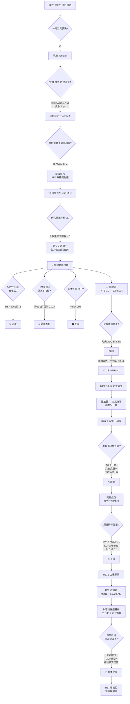

# 报告素材 · 技术篇（合并版 · 2026-10-23）

> **本文件合并自**：`报告补充_开发环境表_20261022.md` + `双板通信技术说明_20261021.md` + `研发历程总结_完整版_20261021.md`
> **用途**：写作品报告 §1.6 / §2.2 / §2.3 / §4.2 时直接取用

---

# 一、开发环境与工具链


# 报告补充：开发环境与工具链（含选择理由 · 2026-10-22）

> **用途**：回复队友第 7 条反馈「缺工具与环境版本」
> **⚠️ 版本均为本机实际查询结果**；"为什么选它"一列对应 `DECISION_LOG` 的实际决策记录

---

## 一、开发环境与工具链（**完整版，可直接粘贴**）

| 类别 | 项目 | 版本 / 型号 | **承担什么** | **为什么选它** |
|---|---|---|---|---|
| **目标器件** | 安路 FPGA | **EG4S20BG256** | 全部算法与控制逻辑的落地载体 | 赛题指定；19600 LUT / 8 MB 片上 SDRAM 足以承载媒体 + 采集双链路 |
| **开发板** | 安路 HX4S20C | **× 2**（主板 + 副板） | 主板负责播放显示，副板负责采集分析 | 赛题指定板卡；**双板分工是为了避免单板资源争抢**（单板实测缺约 600 MSlice） |
| **综合与布局布线** | 安路 Tang Dynasty（TD） | **V6.2.168116**（2025-06-12 构建） | `read_hdl → read_adc → optimize_rtl → read_sdc → optimize_gate → legalize_phy_inst → place → route → bitgen` | 安路官方工具链，**是唯一支持该器件出位流的工具**；每轮出位前必须通过静态时序门禁 |
| **RTL 仿真（主力）** | Verilator | **5.032**（2025-01-01） | 模块级黄金向量比对、变异测试、负控验证 | 编译型仿真，**在本项目规模下比事件驱动仿真快一个量级**；早期用的 Icarus Verilog 已因速度不可用而弃用 |
| **时序级仿真** | ModelSim | **10.5 SE** | 加密 IP 与器件原语的精确时序仿真 | **Verilator 无法处理加密 IP 和厂商原语**，这部分只能用它 |
| **宿主机系统** | Windows | **11（10.0.26200）** | 运行 TD、ModelSim、烧录工具 | TD 只提供 Windows 版本 |
| **仿真 Linux 环境** | WSL Ubuntu | **26.04.1 LTS** | 承载 Verilator 及其编译产物 | Verilator 在 Linux 环境下运行最稳定 |
| **C++ 编译器** | GCC | **15.2.0** | 编译 Verilator 生成的 C++ 模型 | Verilator 的后端依赖 |
| **流程脚本** | Python | **3.13.2** | 自动化流程、证据打包、SHA 校验 | 跨平台、生态成熟，用于把每轮实验的证据链自动固化 |

---

## 二、为什么这样分工（**可直接写进正文**）

> **本作品使用两类仿真，分工明确：**
>
> **Verilator** 承担**绝大部分功能验证** —— 它把 RTL 编译成 C++ 模型，运行速度快，适合跑大规模黄金向量比对与变异测试。
>
> **ModelSim** 只用于 Verilator 无法覆盖的部分 —— 官方加密 IP 与器件原语内部不可见，必须用它做时序级仿真。
>
> **两者的结果互不替代**：Verilator 证明"逻辑对不对"，ModelSim 证明"时序语义对不对"。
>
> **综合与布局布线由安路 TD 完成**，且**每次出位前必须通过静态时序门禁**（Setup ≥ 3.690 ns、Hold ≥ 0.214 ns、PLB ≤ 2450、零违例）。这条门禁是硬性的，不因进度压力放宽。
>
> **交付物本身不依赖任何 PC 端软件** —— 上述工具全部只存在于开发期，运行时的算法与控制逻辑均在 FPGA 内部由 RTL 实现。

---

## 三、⚠️ 三条措辞红线

| # | 不能写 | 原因 |
|---|---|---|
| **1** | 「使用了 XX 开源 RTL 框架」 | 本项目**无第三方 RTL 框架**，均为自研或官方 IP 调用 |
| **2** | 「PC 端软件 / 上位机」 | 合规要求「不得带额外处理器」，必须写清「**开发期工具 ≠ 运行时依赖**」 |
| **3** | 「最新版本」 | 必须写**实际版本号**，评委可能核查 |

---

## 四、建议放置位置

**「§2.3.1 软件整体介绍」末尾**，加小标题「开发环境与工具链」。

- 这一节正好在讲「开发期工具与运行时的界限」，环境表紧接着最自然
- 备选：放附录（若正文已很长）

---

## 五、版本来源（可复核）

| 项 | 查法 | 实测值 |
|---|---|---|
| TD | TD 日志首行 | `Tang Dynasty, V6.2.168116`，Built 2025-06-12 |
| Verilator | `wsl verilator --version` | `Verilator 5.032 2025-01-01` |
| Ubuntu | `wsl lsb_release -d` | `Ubuntu 26.04.1 LTS` |
| GCC | `wsl gcc --version` | `15.2.0` |
| Python | `python --version` | `3.13.2` |
| Windows | 系统信息 | `10.0.26200` |
| ModelSim | 安装目录 | `D:\Modelsim_10.5se\` |

---

## 附录 · 2026-10-22 状态快照（**写报告时注意别写错**）

| 项 | 值 |
|---|---|
| **当前实测可用组合** | **主 R35 / 副 R37** |
| **热重载** | ✅ **三次重载全部成功**（原卡重载 + 换 1920×1440 素材重载） |
| **八槽** | ✅ **保留**（未精简） |
| **音乐续播** | ⛔ **本轮不加** —— 重载后手动重新开播（SW2 开 + 短按 KEY4，从 WAV1 曲头） |
| **保底回退** | 主 R30 `fbe6116e…` / 副 R34B `d66d2c22…` |

**⚠️ 写报告时的口径**：
- **热重载可以写**（已板测三次通过）
- **音乐自动续播不要写**（未实现）
- **"R31E 黑屏原因"不要写成已修复** —— 仍未证实

---

*浮浮酱 ｜ 2026-10-22 ｜ 写版本、写分工、写为什么。*


---

# 二、双板通信技术说明


# 双板通信 · 技术说明（2026-10-21）

> **用途**：作品报告 §2.2.1 / §2.3.1 / §2.3.2 可直接引用的双板通信描述
> **基线**：主 R30 + 副 R34B（已板测）
> **⚠️ 纠正**：网站上旧简介写的「板间**千兆以太网**」**不存在**，实际是 HDMI 线缆承载的低速 GPIO 串行链路。

---

## 0. 一句话

**两块同款 EG4S20 板卡，用一根标准 HDMI 线缆里的 4 根单端信号线，以 1.5625 Mbps 的自定义串行协议双向通信：主板 → 副板传 PCM 参考，副板 → 主板回传频谱。**

---

## 1. 物理层

### 1.1 线缆

| 项 | 值 |
|---|---|
| 线缆 | **一根标准 HDMI 公对公线** |
| 两端 | 分别接主板与副板的 **HDMI-A 座** |
| 芯片侧 | **LVCMOS33 直驱，无 AC 耦合** |
| 地 | 经线缆共地（必需） |
| 建议线长 | **≤ 1 m** |
| ⚠️ 重要 | **只承载单端 GPIO 串行信号，不使用 HDMI 协议** |

**⇒ HDMI 座在这里只是一个多针连接器，与 HDMI 视频传输无关。**

### 1.2 四根信号线

| 线对 | 主板侧 | 副板侧 | 方向 | 用途 |
|---|---|---|---|---|
| **D2** | B3 **输出** | B3 输入（`link_rx_data`） | **主板 → 副板** | **PCM 上行**（TF 回放参考） |
| **D0** | F5 输入 | F5 **输出**（`link_tx_data`） | **副板 → 主板** | **频谱回程** |
| D1 | E3 输出 | E4 恒低 | 主板 → 副板 | 上行 sync 观测 |
| CLK | K1 输出 | J1 恒低 | 主板 → 副板 | 上行 clock 观测（接收端禁用其采样） |

**⇒ 实际参与数据交换的只有 D2 与 D0 两根；D1/CLK 仅作观测。**

### 1.3 电气前置检查（已确认）

| 信号 | 状态 |
|---|---|
| +5V（脚 18）、HPD（脚 19）、DDC（SCL/SDA）、CEC（脚 13） | ✅ **均无冲突**，标准 HDMI 线直连即可 |
| GND | 经线缆共地（必需） |

---

## 2. 协议层（帧格式）

### 2.1 串行速率

```
50 MHz ÷ 32（OSR）= 1.5625 Mbps
```

**⇒ 极低速，信号余量巨大，普通杜邦线都能跑。**

### 2.2 帧结构（160 bit，LSB first）

| 字段 | 长度 | 内容 |
|---|---|---|
| **SYNC** | **16 bit** | `16'hA55A`（明文，不白化） |
| **载荷** | **17 字节**（B0 ~ B16） | **PRBS7 白化** |
| **CRC** | **8 bit** | CRC-8（多项式 0x07），覆盖 B0~B16，**白化** |

**含帧间填充约 177 位/帧。**

### 2.3 帧间填充

**帧与帧之间填 `0101` 交替** —— 目的有两个：

1. **永不匹配 SYNC**，不会误同步；
2. **保证线上恒有跳变**，供对端看门狗判活（断线能被发现）。

### 2.4 载荷字段定义

| 字节 | 含义 |
|---|---|
| **B0 / B1** | 帧序号（模 65536） |
| **B2** | 心跳 + strobe |
| **B3** | `cmd.valid` + `asset`（**1 = PCM / 2 = 频谱 / 3 = 元数据**） |
| **B4** | 高 5 位 = **片号 / 尾包种类**；低 3 位 = **seed** |

---

## 3. 两个方向的数据

### 3.1 主板 → 副板：PCM 上行

| 项 | 值 |
|---|---|
| 内容 | TF 回放的 **16 bit PCM 参考** |
| 缓冲 | **两个 288 样本 bank**（乒乓） |
| 单块时长 | 288 ÷ 48,076.923 Hz ≈ **5.99 ms** |
| 用途 | 副板把它作为 **path0（回放参考谱）**，与麦克风采集的两路谱对比 |

**可靠性设计**：
- ready bank 在**尾包 snapshot 完成前保持只读**，CRC 随描述符冻结；
- 换 bank 时若当前块未写完，会计入 `discarded_partial`（不静默丢数据）。

### 3.2 副板 → 主板：频谱回程

| 项 | 值 |
|---|---|
| 内容 | **多路频谱组**（RAW / POST 等） |
| 每路 | **128 段 × 8 bit** |
| 组大小 | **N × 128 字节**（N = 1~3） |
| 分片 | `ceil(N × 128 / 12)` 片，片号用 B4 高 5 位 |
| 片内字节序 | **路优先**（第 0 路 128 字节在前，每路内部通道 0..127） |

**分片数对照**：

| N | 组字节 | 分片数 | 末片有效字节 |
|---|---:|---:|---:|
| **1** | 128 | **11** | 8（+4 填充） |
| 2 | 256 | 22 | 4（+8 填充） |
| **3** | 384 | **32** | 12（无填充） |

**⚠️ 末片有效字节 = `组字节数 − (分片数−1) × 12`**（通用公式，不得硬编码）。

**用途**：主板收到后与视频画面叠加，形成**同屏双谱对比**。

---

## 4. 可靠性设计

| 机制 | 作用 |
|---|---|
| **SYNC 16'hA55A** | 帧同步 |
| **PRBS7 白化** | 避免长连 0/1，保证边沿密度 |
| **CRC-8（0x07）** | 检出传输错误 |
| **帧间 0101 填充** | 恒有跳变 ⇒ 对端看门狗可判活（断线能被发现） |
| **seed 编码**（8 候选） | 规避「白化后长游程超 RX 看门狗」的静态反例 |
| **双 bank 快照** | PCM 块在发送期间不被覆写 |
| **帧序号** | 检测丢帧 |

### seed 编码的由来（可作为报告的技术细节）

PRBS7 白化是**固定序列异或**，裸 PCM 有可能构造出使线上**连续 102 位无跳变**的数据（含 96 位全零），超过接收端 32 位无边沿看门狗。

**对策**：在应用层用 **8 个候选 seed** 逐一预演，选出不产生长游程的那个，把 seed 装进 B4 低 3 位；收端按 seed 逆映射。**CRC 由发送端对编码后的载荷计算**。

**⇒ 这是应用层的事，不改 038/062 的既有协议契约。**

---

## 5. 设计约束（三条铁律）

| # | 约束 | 含义 |
|---|---|---|
| **1** | **纯 RTL，无从板反馈端口** | 主板**绝不依赖**副板 —— 副板掉线时主板照常播放 |
| **2** | **输入随时锁存，绝不阻塞上游** | 链路慢不影响视频与音频主链 |
| **3** | **跨板信号时序假设为零** | 对端（rx）负责全部异步处理 |

**⇒ 这是"双板解耦"的核心：主板是自足的，副板是增强项。**

---

## 6. 关键数字速查

| 项 | 值 |
|---|---|
| 串行速率 | **1.5625 Mbps** |
| 帧长 | **160 bit**（含填充 177 bit） |
| SYNC | `16'hA55A` |
| CRC | **CRC-8，多项式 0x07** |
| PCM 块 | **288 样本**，约 **5.99 ms** |
| 频谱每路 | **128 段 × 8 bit** |
| 实际数据线 | **2 根**（D2 上行 / D0 回程） |
| 线缆 | 标准 HDMI 公对公，≤1 m |

---

## 7. ⚠️ 报告写作注意事项

| # | 不能说 | 应该说 |
|---|---|---|
| 1 | 「千兆以太网」 | **HDMI 线缆承载的低速 GPIO 串行链路** |
| 2 | 「三种连接模式（复制/主从/扩展）」 | **当前只有一条双向链路 + 一个使能开关** |
| 3 | 「板间传画面」 | **板间传的是 PCM 参考与频谱数据，不传像素** |
| 4 | 「使用 HDMI 协议」 | **只用 HDMI 线缆里的 4 根信号线，不使用 HDMI 协议** |
| 5 | 「拼接/扩展成显示墙」 | **当前为双板采集—对比结构，非拼接墙** |

---

## 8. 一句话总结（可直接放报告摘要）

> **两板之间只用一根 HDMI 线缆中的两根单端信号线，以 1.5625 Mbps 的自定义串行协议双向通信：主板把 TF 回放的 PCM 参考送到副板，副板把滤波前后的两条频谱送回主板同屏显示。协议含 SYNC、PRBS7 白化、CRC-8 与看门狗，且主板不依赖副板的任何反馈，副板掉线不影响主链播放。**

---

*浮浮酱 ｜ 2026-10-21 ｜ HDMI 座只是连接器，链路是自己的协议。*


---

# 三、研发历程总结（含判断依据）


# 作品研发历程 · 完整版（含判断依据）

> **用途**：作品报告 §1.6 设计流程 / §4.2 心得体会；**可直接据此绘制整体历程流程图**
> **依据**：`docs/DECISION_LOG.md`（D-01 ~ D-116）、`LESSONS_LEARNED.md`（LESSON-001 ~ 030）、`BURN_INDEX.md`
> **原则**：**每一条判断都附具体数字；既记录舍弃，也记录新增**

---

## 0. 全项目的一句话总结

**在 19600 个 LUT 的硬约束下，用"先量资源、再决定做不做"的方式，把 116 条决策逐条落地 —— 其中十次舍弃、九次新增、五次转向。**

---

## 一、完整事件表（按时间，含判断依据）

### 阶段一 · 工具链与路线校准（09-26 ~ 10-01）

| 日期 | 类型 | 事件 | **判断依据（数字）** | 结果 |
|---|---|---|---|---|
| 09-26 | 🔄 变更 | 弃用 Icarus Verilog | 本规模下仿真速度不可用 | 统一 **WSL + Verilator** |
| **09-27** | ⛔ **舍弃** | **放弃安路 FFT IP** | IP 最优配置需 **RAM9K 17 块**，主线只余 **7 块**；帧缓存 128 Kb > 预算 36 Kb | **转自研 4096 点 FFT**（最终 DSP 1 / BRAM32K 6 / LUT 5405） |
| 10-01 | ⛔ 舍弃 | 放弃官方通信例程 | 官方例程不可改、吞吐不可见 | 整包采用国一开源方案 |

**⇒ 第一次判断就定下了项目基调：不看"能不能实现"，只看"资源放不放得下"。**

---

### 阶段二 · 双板架构与资源攻坚（10-02 ~ 10-06）

| 日期 | 类型 | 事件 | **判断依据（数字）** | 结果 |
|---|---|---|---|---|
| 10-02 | ➕ **新增** | **双板架构（资源卸载）** | 单板装不下 FFT + 显示 + 音频 | 副板专司 FFT，主板上行 PCM 作参考谱 |
| 10-02 | 🔄 变更 | v7 应用栈 **125 → 50 MHz** | 125 MHz 时序不收敛 | 降频换稳定，记录遗留评估点 |
| 10-03 | ✅ 验证 | 自研 FFT 独立收敛 | 单音对齐 3 组 bin 全中，±3 LSB | FFT 路线成立 |
| **10-06** | ⛔ **负结果** | **600 MSlice 缺口无法用优化填平** | 7 个候选实测节省 **= 0**；估算上界 0~26 MSlice，仍差 **574~600** | **确认"加功能"此路不通** |
| **10-06** | 🔄 **转向** | **主人裁定「分级交付」** | 上述负结果 | 从"一次做全"改为"分批交付" |

**⚠️ 阶段二的关键判断（`DECISION_LOG` D-29 原文）**：

> **芯片 9800 slice（每 slice = 2 LUT + 2 FF）；设计需 9873 ⇒ 缺 73。**

**⇒ 从此，资源账成为一切功能的准入前提。**

---

### 阶段三 · 大规模试错与取舍（10-08 ~ 10-13）

| 日期 | 类型 | 事件 | **判断依据（数字）** | 结果 |
|---|---|---|---|---|
| 10-11 | ⛔ **舍弃** | **D1 转场替换** | 完整 B1：**MS 4976 / LS 4977**（超 76/77），比对照**还多 40** | 否决 |
| 10-11 | ⛔ **舍弃** | **D2 转场探针** | 只有 **−2 MS / −3 LS**，未达先验门槛 | 停止 |
| 10-11 | ✅ 验证 | **R2 面积优化成功** | 独立增量 **35/29 → 19/13** | 通过事前冻结门槛 |
| 10-12 | ⛔ **舍弃** | **HDMI 自研替换（第 1 轮）** | round01 未达门槛 | 拒 |
| 10-12 | ⛔ **舍弃** | **HDMI 自研替换（第 2 轮）** | 修好 BCH 表错误、44,608 条检查、四负控通过，**route 实测只 −23/−24**，门槛 64 | 拒 |
| 10-12 | ⛔ **舍弃** | **以太网 / 上位机** | 整套 **≈4.0k LUT**（UDP 2948 加密不可裁 + TEMAC 493 + …）；主板已超 9/9，副板 PLB 余 497 需 900+ | 主人裁定不加入 |
| **10-12** | ✅ **重大回收** | **删除歌词子系统** | **MS −473 / LS −473 / PLB −288 / LUT −1960 / REG −766 / RAM9K −7** | **远超缺口，全项目最大单次回收** |
| 10-12 | ⛔ 舍弃 | **任意比例缩放（A 路线）** | 需 **35/35 MS/LS** | 主人放宽"铺满"要求 ⇒ 整条不做 |
| 10-12 | ⛔ 舍弃 | **任意角度旋转** | — | 只保留 **90/180/270** |
| 10-12 | ➕ 新增 | 键表三模式 + 仪表盘 + 参数调节 | 主人交互需求 | 交互规格成型 |

**⇒ 阶段三的核心：五次尝试被数据否决，一次删除大获成功。**

---

### 阶段四 · 采集路线三次变更（10-12 ~ 10-13）

| 版本 | 方案 | **判断依据** | 结果 |
|---|---|---|---|
| 初版 | 片内 SAR ADC + 模拟麦克风 | 精度仅 **8 bit 有效** | ❌ 太差 |
| 二版 | PDM 数字 MEMS + CIC 抽取 | 抽取滤波在 FPGA 内，合规最好；**约 70 slice/通道** | 🟡 面积偏大 |
| **最终** | **I2S 数字 MEMS（INMP441）** | 官方原文**只禁"额外处理器"**，未见禁 codec；**一份接收器全通道共享** | ✅ 主人裁定 |

**⇒ 这是一次"合规口径纠正"：浮浮酱此前给自己加了一条并不存在的限制。**

---

### 阶段五 · 定位转变（10-14）—— **全项目转折点**

| 项 | 判断依据 | 转变 |
|---|---|---|
| 名称 | 原写"离线音频播放器"，**"播放器"三字不呼应选题的"对比"** | **今非昔比 · 双板「现场声—回放声」对比终端** |
| 主线 | 原只有"播放 + 显示频谱" | **两条对比轴**：① 今 vs 昔　② 处理前 vs 处理后 |
| 场景 | 泛泛多媒体 | **工业设备噪声治理（50 Hz 工频及谐波）** |

**⇒ 这一改让作品从"又一个播放器"变成"有明确工程用途的对比终端"。**

---

### 阶段六 · 陷波、双谱与交互（10-17 ~ 10-19）

| 日期 | 类型 | 事件 | **判断依据** | 结果 |
|---|---|---|---|---|
| 10-17 | ➕ 新增 | 副板 mic 改 **150 Hz–2 kHz 四节带阻** | 单点陷波听感不明显；8 阶 Butterworth 更可听 | 落地 R10 |
| 10-17 | ➕ 新增 | **双谱「对比对」** | 让"处理前后"能同屏看 | 方案 A（SW3 两态） |
| 10-17 | ➕ 新增 | **外接功放输出（第一步）** | 主人原话：「只有滤波显示却没有实际输出的听感无法体现作品使用价值」 | MAX98357A，L=RAW / R=POST |
| 10-17 | ⛔ 舍弃 | **LMS 自适应抵消** | **10 天做不完**；效果只在**几厘米**；**不敢承诺 dB 数** | D-100 暂缓 |
| 10-17 | ⛔ 舍弃 | **无线播放音频** | 合规（模块必带处理器）+ 资源 + 时间 | 不做 |
| 10-18 | ➕ 新增 | **模式三**（SW3 开 = 双谱 + K2 短按 TF 陷波） | 原有 SW3/SW4 功能重叠，需腾出 SW4 | D-102 |
| 10-18 | ⛔ 舍弃 | **TF→HDMI 陷波**（后续取消） | 交互简化 | 最终取消 |
| 10-19 | ➕ 新增 | **模式四两键**（K2 转场开关 / K3 仪表盘开关） | 主人要"基础与拓展分开演示" | D-105 |
| 10-19 | ➕ 新增 | **轮播周期 1~60 秒可调** | 主人要"轮播时及时体现更改"，放 mode 0 子模式 | 避开乘法，省 LUT |
| 10-19 | ➕ 新增 | **仪表盘显示 TRANS/PERIOD** | 主人要"转场开关和周期时间加到仪表盘" | D-106 |

---

### 阶段七 · 分辨率评估与保底交付（10-19 ~ 10-21）

| 日期 | 类型 | 事件 | **判断依据（数字）** | 结果 |
|---|---|---|---|---|
| 10-19 | ⛔ 舍弃 | **「原分辨率显示」** | ① LVDS **800 Mbps** 上限（1080p 需 1485）② 片上 SDRAM **8 MB**（1080p 双缓冲 8.29 MB）③ PLB 余 **32** | 不做；改用仪表盘显示源尺寸 |
| 10-19 | ⛔ 舍弃 | **网口接收 PC 图片** | 以太网 ≥数百 LUT；task_052 曾失败；9 天做不完 | D-108 |
| 10-19 | ➕ 新增 | **T18 前四槽提前演示** | 主人要"八张分两次展示，前四张加载快" | 图墙本就是两组各 4 格 |
| 10-20 | ⛔ **负结果** | **R31E 上板完全无信号** | 离线 B1 **3.931/0.214、PLB 2343、五轮审查全过** → **上板黑屏** | 撤出推荐 |
| 10-20 | ⛔ **负结果** | **R32 改引脚 G16→P4** | Setup **0.211 → 0.132 ns**（门禁 0.200），欠 **0.068** | FAIL，无 bit |
| 10-20 | ⛔ 舍弃 | **资源回收（防御性冗余审查）** | 审查结论：**无千 LUT 级可回收块**；旋转/A 类缩放已被综合消除 | 资源见底 |
| 10-20 | ➕ 新增 | **三麦均值融合** | 主人接了 MIC2/3/4，问"均值还是中值" | 选**均值**（≈9 LUT 实测） |
| **10-21** | 🔒 **冻结** | **保底可交付基线** | 主 R30 `fbe6116e…` + 副 R34B `d66d2c22…`，9 项能力板测确认 | 任何失败回退到这里 |
| 10-21 | ❌ 取消 | **T23 迁脚 P4** | 中继板已拆 ⇒ G16 直接可接；且 R32 已证明会失败 | D-114 |
| **10-21** | ➕ **新增** | **T24 声学反相抵消（500 Hz）** | ① 中继板拆除 ⇒ 麦克风可任意摆位 ② 副板 DSP 余 **27** ③ PLB 余 **224** ④ 相位预算已算出可行 | R37 已出位，**未做声学实测** |

---

## 二、九次"新增"及其理由（与十次"舍弃"对称）

| # | 新增的 | 触发 | 判断依据 | 结果 |
|---|---|---|---|---|
| 1 | **双板架构** | 单板装不下 | 缺 600 MSlice | ✅ 落地 |
| 2 | **自研 FFT** | IP 放不下 | 需 17 块 RAM9K，只余 7 | ✅ 落地 |
| 3 | **固定带阻（150 Hz–2 kHz）** | 单点陷波听感弱 | 8 阶 Butterworth 更可听 | ✅ 落地 |
| 4 | **双谱对比（RAW/POST）** | 需要"处理前后"同屏 | 同索引双谱保证可比 | ✅ 落地 |
| 5 | **外接功放输出** | 「没有实际输出无法体现价值」 | 主人原话 | ✅ 落地 |
| 6 | **三麦均值** | 主人接了 3 路麦 | 同板小间距，均值降方差 | ✅ 落地（实测 +9 LUT） |
| 7 | **模式三 / 模式四** | 基础与拓展需分开演示 | 键位重构 | ✅ 落地 |
| 8 | **轮播周期可调 / 仪表盘状态** | 演示节奏可控 | 避开乘法，省 LUT | ✅ 落地 |
| 9 | **声学反相抵消（T24）** | 主人明确要求"就要声学抵消" | 条件已变：麦可摆位、DSP 余 27 | ⏳ 待实测 |

---

## 三、整体历程流程图（**可直接用于绘图**）



---

## 四、判断模式总结（**可写进心得的核心**）

### 4.1 每一个"做不做"的决定，都先回答三个问题

```text
① 资源放得下吗？     → 用 B1 实测的 PLB/LUT/REG/DSP/BRAM，不用估算
② 收益能兑现吗？     → 要完整 B1 实测，不接受"模块省了"外推
③ 失败能回退吗？     → 有保底位，才敢试新功能
```

### 4.2 十次舍弃的共同特征

| 舍弃项 | 舍弃时的**决定性数字** |
|---|---|
| FFT IP | RAM9K 需 17，余 7 |
| D1/N 转场 | MS 4976 > 门禁 |
| HDMI 自研 | 回收 23/24 < 门槛 64 |
| 以太网 | 4.0k LUT |
| 任意比例缩放 | 35/35 MS/LS |
| 歌词 | （保留是负收益，删了 −1960 LUT） |
| 任意角度旋转 | 只保留 3 个角度 |
| LMS | 10 天 + 几厘米 + 无 dB |
| 无线 | 合规 + 资源 + 时间 |
| 原分辨率 | 800 Mbps / 8 MB / 32 LUT |

**⇒ 没有一次是"感觉不行"，全部是"数字不行"。**

### 4.3 九次新增的共同特征

| 新增项 | 通过时的**决定性数字/依据** |
|---|---|
| 双板 | 单板缺 600 MSlice |
| 自研 FFT | 最终 5405 LUT，比 IP 可行 |
| 带阻 | 8 阶 Butterworth 可听 |
| 双谱 | 同索引保证可比 |
| 功放 | 主人原话"没有实际输出无法体现价值" |
| 三麦均值 | 实测 +9 LUT，副板余 224 |
| 模式三四 | 演示需分段 |
| 轮播/仪表盘 | 避开乘法，省 LUT |
| ANC | 条件已变（摆位 / DSP 余 27 / 相位预算） |

---

## 五、五次转向

| # | 从 | 到 | 决定性依据 |
|---|---|---|---|
| 1 | 单板 | **双板** | 缺 600 MSlice |
| 2 | 官方通信底座 | **国一开源协议** | 官方不可改、吞吐不可见 |
| 3 | 片内 ADC | **I2S 麦克风** | 8 bit 精度 + 合规口径纠正 |
| 4 | 播放器 | **对比终端** | "播放器"不呼应选题的"对比" |
| 5 | 做更多功能 | **保底交付优先** | R31E 上板黑屏，风险不可控 |

---

## 六、可写进心得的六条真实经历（带数字）

| # | 经历 | 关键数字 |
|---|---|---|
| ① | **能综合通过 ≠ 能上板** | R31E：离线 3.931/0.214、PLB 2343、五审全过 → **上板黑屏** |
| ② | **时序余量意味着什么** | 仅改一个引脚 G16→P4，Setup **0.211 → 0.132** |
| ③ | **仿真通过 ≠ 功能正确** | 测试台 `force` 掉 `rescan_*`，热重载故障永远测不出 |
| ④ | **资源账不能相加** | +147 与 −264 相加 = −117，实际 **−217**，差 **100 LUT** |
| ⑤ | **"看着没用"的模块未必能删** | 歌词 11 文件从未实例化；旋转 DMA 已被综合消除 |
| ⑥ | **证据对了，结论越界** | 卡上实为 **60.96 MB 原分辨率大图**，不是 640×480 |

---

## 七、⭐ 一个值得单列的故事：**删歌词救了整个项目**

| 项 | 数值 |
|---|---|
| 触发 | Stage11 六笔账探针 |
| 发现 | 歌词子系统**从未被实例化** |
| 回收 | **MS −473 / LS −473 / PLB −288 / LUT −1960 / REG −766 / RAM9K −7** |
| 意义 | **单次最大回收**，直接支撑后续所有功能 |

**⇒ 有时候，"不做什么"比"做什么"更能决定成败。**

---

## 八、使用建议

| 用途 | 用本文哪部分 |
|---|---|
| **§1.6 设计流程**（≤200 字 + 图） | **§三 流程图** + §4.1 三问 |
| **§4.2 心得体会**（≤1000 字） | **§六 挑 2~3 条** + §七 |
| **答辩口头讲述** | §四 判断模式 + §五 五次转向 |
| **流程图绘制** | **§三 Mermaid 图可直接渲染** |

**⚠️ 心得不要六条全写** —— 1000 字装不下，会变流水账。

---

*浮浮酱 ｜ 2026-10-21 ｜ 每一次判断都留下数字，才经得起追问。*
